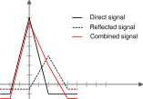

# Exercises: PRN codes

## 1. Linear Feedback Shift Register (LFSR)

Given the following mathematical representation of a linear feedback shift register (LFSR):

$$
1+x+x^4
$$

1. Make the block diagram representation of the LFSR
2. What is the theoretical maximum length of the sequence generated by this LFSR?
3. What is the maximum length of the sequence generated by this LFSR if we initialize it with `1111`?

$$
\pagebreak
$$

### Answer

1. The block diagram representation of the LFSR is shown below:

1. The theoretical maximum length of the sequence generated by this LFSR is $2^4-1 = 15$ bits, since the degree of the polynomial is 4.
2. The actual length can be computed by simulating the LFSR with the initial state `1111`. The sequence generated will be:

| Step | R1  |  R2  |  R3  |  R4  | Feedback |
|:----:|:---:|:----:|:----:|:----:|:--------:|
| 1    |  1  |  1   |   1  |   1  |     0    |
| 2    |  0  |  1   |   1  |   1  |     1    |
| 3    |  1  |  0   |   1  |   1  |     0    |
| 4    |  0  |  1   |   0  |   1  |     1    |
| 5    |  1  |  0   |   1  |   0  |     1    |
| 6    |  1  |  1   |   0  |   1  |     0    |
| 7    |  0  |  1   |   1  |   0  |     0    |
| 8    |  0  |  0   |   1  |   1  |     1    |
| 9    |  1  |  0   |   0  |   1  |     0    |
| 10   |  0  |  1   |   0  |   0  |     0    |
| 11   |  0  |  0   |   1  |   0  |     0    |
| 12   |  0  |  0   |   0  |   1  |     1    |
| 13   |  1  |  0   |   0  |   0  |     1    |
| 14   |  1  |  1   |   0  |   0  |     1    |
| 15   |  1  |  1   |   1  |   0  |     1    |
| 16   |  1  |  1   |   1  |   1  |     0    |

`010110010001111` is the sequence generated, which has a length of 15 bits. Therefore, the maximum length of the sequence generated by this LFSR when initialized with `1111` is 15 bits.

Note that step 16 returns to the initial state, confirming that the sequence has cycled through all possible states except the all-zero state.

$$
\pagebreak
$$

## 2. Code auto-correlation

A length-7 Gold code is generated by the modulo-2 sum (XOR) of two maximal-length sequences produced by the LFSRs $1+x+x^3$ and $1+x^2+x^3$, both initialized with `111`:

- $a = 1110100$
- $b = 1110010$

Answer the following questions:

1. Why is 7 the maximum length of the Gold code generated by these two LFSRs?
2. Compute the resulting Gold code $g = a \oplus b$
3. Convert $g$ to its bipolar form ($0 \rightarrow +1$, $1 \rightarrow -1$).
4. Compute manually the circular auto-correlation $R_g(k)=\sum_{i=0}^{6} g_i\, g_{(i+k) \bmod 7}$ for all delays $k=0,\dots,6$.
5. What is the peak value? Which values take the remaining delays? What is the ratio between the peak and the highest side lobe?

$$
\pagebreak
$$

### Answer

1. $g = a \oplus b = 0000110$.
2. $g = 0000110 \rightarrow (+1,+1,+1,+1,-1,-1,+1)$.
3. For each delay, shift $g$ circularly to the left by $k$ chips, multiply chip by chip with the original code and add:

| $k$ | Shifted code $g_{i+k}$ | Product $g_i g_{i+k}$ | $R_g(k)$ |
|:---:|:----------------------:|:---------------------:|:--------:|
|  0  |   `+ + + + - - +`      |     `+ + + + + + +`   |  **7**   |
|  1  |   `+ + + - - + +`      |     `+ + + - + - +`   |    3     |
|  2  |   `+ + - - + + +`      |     `+ + - - - - +`   |   -1     |
|  3  |   `+ - - + + + +`      |     `+ - - + - - +`   |   -1     |
|  4  |   `- - + + + + +`      |     `- - + + - - +`   |   -1     |
|  5  |   `- + + + + + -`      |     `- + + + - - -`   |   -1     |
|  6  |   `+ + + + + - -`      |     `+ + + + - + -`   |    3     |

4. The peak is $R_g(0)=7$ (the code length). The other delays take the values $-1$ or $3$, i.e. the highest side lobe is 3, so the peak is $7/3 \approx 2.3$ times larger. The sharp peak at $k=0$ is what allows the receiver to estimate the code delay. For a real 1023-chip Gold code the peak is 1023 and the side lobes are at most 65 in magnitude (-1, -65 or 63).

$$
\pagebreak
$$

## 3. Code cross-correlation

Consider the Gold code $g = 0000110$ of the previous exercise and a second code of the same family, $h = 1011010$ (the XOR of $a$ and $b$ delayed by 4 chips).

1. Because the polynomials have a degree of 3, the maximum length of the Gold code is $2^3-1=7$.
2. Convert $h$ to bipolar form.
3. Compute manually the circular cross-correlation $R_{g,h}(k)=\sum_{i=0}^{6} g_i\, h_{(i+k) \bmod 7}$ for $k=0,\dots,6$.
4. Compare the result with the auto-correlation of exercise 2. Is there a clear peak for $g$ when correlating with $h$? What does this mean for the receiver? What are the values of the cross-correlation compared with the auto-correlation peak?
5. Why can different satellites share the same frequency?

$$
\pagebreak
$$

### Answer

1. $h = 1011010 \rightarrow (-1,+1,-1,-1,+1,-1,+1)$, and $g=(+1,+1,+1,+1,-1,-1,+1)$.
2. Same procedure as before, but shifting $h$:

| $k$ | Shifted code $h_{i+k}$ | Product $g_i h_{i+k}$ | $R_{g,h}(k)$ |
|:---:|:----------------------:|:---------------------:|:------------:|
|  0  |    `- + - - + - +`     |    `- + - - - + +`    |      -1      |
|  1  |    `+ - - + - + -`     |    `+ - - + + - -`    |      -1      |
|  2  |    `- - + - + - +`     |    `- - + - - + +`    |      -1      |
|  3  |    `- + - + - + -`     |    `- + - + + - -`    |      -1      |
|  4  |    `+ - + - + - -`     |    `+ - + - - + -`    |      -1      |
|  5  |    `- + - + - - +`     |    `- + - + + + +`    |       3      |
|  6  |    `+ - + - - + -`     |    `+ - + - + - -`    |      -1      |

3. The cross-correlation is $-1$ for all delays but one ($3$), whereas the auto-correlation peak is 7. Secondary peak values are (-1, 3), the same as the secondary values of the auto-correlation. The cross-correlation values are much lower than the auto-correlation peak, which means that a receiver correlating with $g$ will see a clear peak for $g$ and only low-level noise-like values for $h$. This is important for distinguishing between different codes in a CDMA system.
4. Values are small compared with the peak, so a receiver correlating with the replica of $g$ will see a clear peak for $g$ and only low-level noise-like values for $h$. This is why all GPS satellites can transmit simultaneously on the same frequency (CDMA). The effect is much stronger with 1023 chips: the peak is 1023 while cross-correlation values are bounded by 65 (about -36 dB).

$$
\pagebreak
$$

## 4. Multipath and autocorrelation

Consider the same Gold code $g$ as in the previous exercises. Assume that the signal received by a GPS receiver is a combination of the direct signal and a multipath signal that is delayed by 2 chips and attenuated by a factor of 0.5.

1. Draw a diagram showing the direct and multipath signals
2. What is the resulting signal after correlation?
3. What is the effect of multipath on the correlation peak?

$$
\pagebreak
$$

### Answer

1. Diagram
2. Diagram

3. The resulting signal after correlation will be a combination (sum) of the two correlation peaks thus giving a wider peak. The multipath signal will create a secondary peak at a delay of 2 chips, which can interfere with the detection of the main peak. This can lead to inaccuracies in determining the correct timing and position.

$$
\pagebreak
$$

## 5. Spreading and despreading

A data signal has two bits, $m=[+1,-1]$. Each bit is spread using the four-chip code
$c=[+1,-1,+1,-1]$. Assume a constant additive interference of $0.5$ is present on every received chip.

1. Write the eight-chip transmitted sequence.
2. Add the interference to obtain the received sequence.
3. Despread by multiplying each group of four received chips by $c$, then sum each group. What data bits are recovered?
4. Explain why this example illustrates the processing gain of direct-sequence spread spectrum, and why it does not mean that all interference is always removed.

$$
\pagebreak
$$

### Answer

1. Multiply each data bit by all four chips of the code:
   $$
   s=[+1,-1,+1,-1,\;-1,+1,-1,+1].
   $$
2. Adding $0.5$ to every chip gives
   $$
   r=[1.5,-0.5,1.5,-0.5,\;-0.5,1.5,-0.5,1.5].
   $$
3. Multiplication by $c$ chip by chip gives
   $$
   [1.5,-0.5,1.5,-0.5]\odot c=[1.5,0.5,1.5,0.5],\qquad \text{sum}=4,
   $$
   $$
   [-0.5,1.5,-0.5,1.5]\odot c=[-0.5,-1.5,-0.5,-1.5],\qquad \text{sum}=-4.
   $$
   Dividing by the code length gives $[+1,-1]$, the original data bits.
4. Despreading combines the desired signal coherently across the chips, while this constant interference cancels because the code has two $+1$ and two $-1$ chips. Real interference is not necessarily constant across a code period or uncorrelated with the spreading code, so it is generally reduced rather than guaranteed to disappear.

$$
\pagebreak
$$

## 6. Sharing a channel: multiplexing

Three services need to transmit at the same time:

- Service A is assigned a repeating time slot.
- Service B transmits in a separate frequency band.
- Service C shares both the time and frequency resources with other users but has its own spreading code.

1. Identify the multiplexing technique used by each service.
2. Which technique is used by GPS, Galileo, and BeiDou for their conventional ranging signals? What distinguishes the satellites in that system?
3. GLONASS historically used a different technique for many of its signals. Name it and explain how satellites are separated.
4. Does assigning different spreading codes make real signals perfectly orthogonal for every possible delay? Briefly explain.

$$
\pagebreak
$$

### Answer

1. Service A uses time division multiple access (TDMA), Service B uses frequency division multiple access (FDMA), and Service C uses code division multiple access (CDMA).
2. GPS, Galileo, and BeiDou use CDMA for their conventional ranging signals. Satellites transmit in the same time and frequency resources using different ranging codes, which lets a receiver correlate against a selected satellite's code.
3. GLONASS historically used FDMA for many signals. Satellites are assigned different carrier-frequency slots within a band. Newer GLONASS signals also include CDMA.
4. No. Codes are designed to have low cross-correlation, but distinct codes are not necessarily orthogonal at every relative delay. Their residual cross-correlation can contribute interference at a receiver.

$$
\pagebreak
$$

## 7. BOC and CBOC modulation

The notation BOC$(n,m)$ uses subcarrier frequency $n \times 1.023$ MHz and spreading-code chip rate $m \times 1.023$ MHz.

1. For BOC$(2,1)$, calculate the subcarrier frequency, chip rate, and number of subcarrier cycles per code chip.
2. If a code chip is $+1$ and the subcarrier starts at $+1$ at the beginning of the chip, write the four successive half-cycle signs over that chip.
3. How does the BOC spectrum differ qualitatively from a BPSK signal's spectrum, and what is one motivation for using BOC?
4. Galileo E1 CBOC combines BOC$(1,1)$ and BOC$(6,1)$ with amplitudes $\alpha=\sqrt{10/11}$ and $\beta=\sqrt{1/11}$. What fraction of the component power is assigned to the high-frequency BOC component, assuming the components are uncorrelated?
5. What correlation-tracking challenge can the split or multi-lobed BOC correlation shape introduce?

$$
\pagebreak
$$

### Answer

1. The subcarrier frequency is $2.046$ MHz and the code chip rate is $1.023$ Mchips/s. The subcarrier-to-chip ratio is $2/1$, so there are two subcarrier cycles per code chip.
2. Each cycle has two half-cycles. With a $+1$ code chip, the product over the chip is $[+1,-1,+1,-1]$.
3. BOC shifts energy away from the carrier and produces a split spectrum, unlike the central-lobed BPSK spectrum. This can improve spectral separation from other signals and robustness to interference or multipath.
4. The high-frequency component's power fraction is $\beta^2=1/11\approx 9.1\%$; the remaining $10/11$ is assigned to the BOC$(1,1)$ component.
5. The correlation function can have secondary or side peaks. A receiver may lock onto a side peak instead of the main peak, creating a code-delay error unless its tracking method resolves the ambiguity.

$$
\pagebreak
$$

## 8. GPS L1 C/A signal components and timing

For this exercise, use the GPS L1 C/A values from the slides: carrier frequency $f_c=1575.42$ MHz, C/A chip rate $R_c=1.023$ Mchips/s, code length $N=1023$ chips, and navigation-message rate $R_b=50$ bits/s.

1. Calculate the duration of one C/A code period and one navigation bit.
2. How many C/A code periods, and how many chips, occur during one navigation bit?
3. In the simplified in-phase model $I(t)$ contains the navigation data and ranging code, while the carrier is $\cos(2\pi f_ct)$. Identify the role of each of these three factors.
4. GPS signals use right-hand circular polarization (RHCP). Give one reason for using circular rather than linear polarization.
5. Name the modulation and multiplexing techniques associated with the GPS L1 C/A ranging signal in the slides.

$$
\pagebreak
$$

### Answer

1. One C/A code period is
   $$
   T_{\text{code}}=\frac{1023}{1.023\times 10^6}=0.001\text{ s}=1\text{ ms}.
   $$
   One navigation bit lasts
   $$
   T_b=\frac{1}{50}=0.02\text{ s}=20\text{ ms}.
   $$
2. There are $20\text{ ms}/1\text{ ms}=20$ code periods per navigation bit, or $20\times1023=20{,}460$ chips.
3. The navigation data carries information such as satellite clock and orbit parameters; the ranging code spreads the data and supports signal identification and delay measurement; the carrier translates the signal to the radio-frequency band.
4. Circular polarization is less susceptible to severe amplitude fading caused by changing antenna orientation and ionospheric Faraday rotation than a linearly polarized signal.
5. The GPS L1 C/A ranging component uses BPSK(1) modulation and CDMA multiplexing.

$$
\pagebreak
$$

## 9. GPS navigation-message structure

The GPS L1 C/A navigation message is transmitted at 50 bits/s. A frame contains 1500 bits and is divided into five equal subframes.

1. Calculate the duration of one frame and one subframe.
2. How many bits are in each subframe?
3. How long does it take to transmit a 12.5-minute complete message, and how many 30-second frames does it contain?
4. Which information is carried in subframes 1, 2, and 3? What is the distinction between ephemeris and almanac data?
5. Why does a receiver benefit from receiving the navigation message in addition to acquiring the ranging code?

$$
\pagebreak
$$

### Answer

1. A frame lasts $1500/50=30$ s. Each of its five subframes lasts $30/5=6$ s.
2. Each subframe contains $1500/5=300$ bits.
3. Twelve and a half minutes is $750$ s, so the complete message contains $750/30=25$ frames.
4. Subframe 1 carries clock-correction parameters and signal biases; subframes 2 and 3 carry ephemeris parameters. Ephemeris is precise orbit information for the transmitting satellite, while almanac data is coarser orbit and status information for satellites across the constellation.
5. The ranging code lets a receiver identify and time the signal, but the navigation message supplies data needed to compute satellite position and correct its clock. Those are needed, along with measurements from multiple satellites, to calculate the receiver's position and time.
