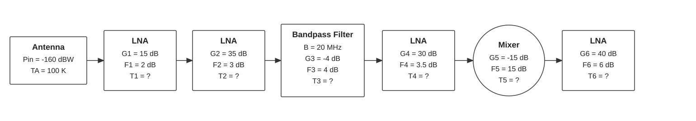

# Exercises: Receivers

Unless stated otherwise, use

$$
\begin{aligned}
c&=3.00\times10^8\ \mathrm{m/s}, \\
k&=1.38\times10^{-23}\ \mathrm{J/K}, \\
\end{aligned}
$$

## Architecture and receiver design

A receiver for a hiking phone must be inexpensive and run for a long time. A second receiver is used for land surveying and must support centimetre-level positioning.

1. For each receiver, choose which matters more: low power, short time to first fix, sensitivity, multiple frequencies, or stable carrier-phase measurements.
2. A designer can either add a second frequency or reduce the number of tracked signals to save power. Which choice would you make for each receiver, and why?

$$
\pagebreak
$$

### Answer

- The phone will usually prioritize low power, low cost, fast startup and adequate sensitivity; the survey unit prioritizes stable carrier-phase tracking, multiple frequencies, high sensitivity and accuracy. A second frequency is more valuable to surveying; the phone may prefer fewer channels or simpler tracking to reduce power.

$$
\pagebreak
$$

## RF front end: bandwidth and noise

A receiver has system noise temperature $T_{sys}=300\ \mathrm{K}$, RF bandwidth $B=4\ \mathrm{MHz}$, and received carrier-to-noise density $C/N_0=42\ \mathrm{dB\,Hz}$.

1. Compute the noise spectral density $N_0=kT_{sys}$ in dBW/Hz.
2. Compute the noise power in the receiver bandwidth and the corresponding SNR.
3. If the bandwidth is doubled while $C/N_0$ stays the same, what happens to the in-band SNR? Explain why this does not mean the satellite signal itself became weaker.

$$
\pagebreak
$$

### Answer

1. $N_0=4.14\times10^{-21}\ \mathrm{W/Hz}\approx-203.8\ \mathrm{dBW/Hz}$.
2. In 4 MHz, $N_0B\approx1.66\times10^{-14}\ \mathrm{W}\approx-137.8\ \mathrm{dBW}$.
3. SNR is $42-10\log_{10}(4\times10^6)\approx-24.0\ \mathrm{dB}$. Doubling bandwidth adds about 3 dB of noise and lowers in-band SNR by 3 dB; $C/N_0$ remains fixed.

$$
\pagebreak
$$

## ADC sampling and data rate

After downconversion, a receiver passes a signal with a bandwidth of $4\ \mathrm{MHz}$ to its ADC. It samples at $8\ \mathrm{MSamples/s}$ using 2-bit quantization.

1. Is this sampling rate at the Nyquist limit for a real-valued signal of this bandwidth?
2. What is the raw sample data rate in Mbit/s for one channel?
3. What would the data rate be at 4 bits per sample? Name one benefit and one cost of increasing the number of bits.

$$
\pagebreak
$$

### Answer

1. 8 MSamples/s is the Nyquist rate for a real 4 MHz low-pass bandwidth.
2. At 2 bits the raw rate is 16 Mbit/s;
3. at 4 bits it is 32 Mbit/s. More bits preserve amplitude/dynamic range better, at the cost of data rate, power and storage.

$$
\pagebreak
$$

## Acquisition: code and Doppler bins

A cold-start receiver searches one GPS L1 C/A code period with half-chip delay spacing. It searches Doppler from $-6\ \mathrm{kHz}$ through $+6\ \mathrm{kHz}$, using 4 ms coherent integration.

1. There are 1023 chips per code period. How many code-delay bins are searched?
2. Use Doppler-bin spacing $\Delta f=1/(2T_{int})$. How many Doppler bins are needed to cover the range, approximately?
3. Estimate the total number of delay–Doppler cells. Why can a longer integration both improve detection and increase the search cost?

$$
\pagebreak
$$

### Answer

1. Delay bins: $1023/(0.5)=2046$.
2. Doppler spacing is 125 Hz, giving 96 bins over 12 kHz.
3. Total: about $196{,}416$ cells. Longer coherent integration improves processing gain, but narrows Doppler bins and increases the search workload (and can be constrained by data-bit transitions).

$$
\pagebreak
$$

## Tracking: read a DLL discriminator

Use a normalized early-minus-late discriminator

$$D=\frac{E-L}{E+L}.$$

For one integration, the early and late correlator magnitudes are $E=0.72$ and $L=0.48$. For this exercise, positive $D$ means the local code replica is late and should be advanced.

1. Compute $D$.
2. Is the local code early, aligned, or late? Which direction should the code replica move?
3. If the signal becomes weaker but the same integration time is retained, what happens to the reliability of this decision?

$$
\pagebreak
$$

### Answer

1. $D=(0.72-0.48)/(0.72+0.48)=0.20$.
2. Under the stated sign convention, the local code is late and should be advanced.
3. Lower signal strength makes noise a larger fraction of the correlator outputs and makes the decision less reliable.

$$
\pagebreak
$$

$$
\pagebreak
$$

## RF Front-End: Noise power and noise figure

In the following system:

Compute the following parameters:

1. Receiver noise temperature: $T_R$
2. Systemnoise temperature: $T_{sys}$
3. Receiver gain: $G$
4. Equivalent spectral noise density at the input of the receiver: $N_{0,in}$
5. Equivalent spectral noise density at the output of the receiver: $N_{0,out}$
6. Signal power at the output of the receiver: $P_{out}$
7. Noise power at the output of the receiver: $N_{out}$
8. SNR at the output of the receiver: $SNR_{out}$
9. Carrier to spectral noise density at the output of the reciever: $(C/N_0)_{out}$

$$
\pagebreak
$$

### Answer

1. Noise temperature $T_R$

First we need to compute the noise figure for the whole system (Friss formula).

$$
\begin{aligned}
F_1 &= 2 \ dB = 10^{\frac{2}{10}} = 1.58 & \qquad G_1 &= 15 \ dB = 10^{\frac{15}{10}} = 31.623 \\
F_2 &= 3 \ dB = 10^{\frac{3}{10}} = 1.995 & \qquad G_2 &= 35 \ dB = 10^{\frac{35}{10}} = 3162.28 \\
F_3 &= 4 \ dB = 10^{\frac{4}{10}} = 2.512 & \qquad G_3 &= -4 \ dB = 10^{\frac{-4}{10}} = 0.398 \\
F_4 &= 3.5 \ dB = 10^{\frac{3.5}{10}} = 2.239 & \qquad G_4 &= 30 \ dB = 10^{\frac{30}{10}} = 1000 \\
F_5 &= 15 \ dB = 10^{\frac{15}{10}} = 31.623 & \qquad G_5 &= -15 \ dB = 10^{\frac{-15}{10}} = 0.0316 \\
F_6 &= 6 \ dB = 10^{\frac{6}{10}} = 3.98 & \qquad G_6 &= 40 \ dB = 10^{\frac{40}{10}} = 10000 \\
\end{aligned}
$$

$$
\begin{aligned}
F &= 1.58 + \frac{1.995-1}{31.623} + \frac{2.512-1}{31.623 \cdot 3162.28} \\
&+ \frac{2.239-1}{31.623 \cdot 3162.28 \cdot 0.398} + \frac{31.623-1}{31.623 \cdot 3162.28 \cdot 0.398 \cdot 1000} \\
&+ \frac{3.98-1}{31.623 \cdot 3162.28 \cdot 0.398 \cdot 1000 \cdot 0.0316} \\
&= 1.58 + 0.0315 + 0.000015 + 0.000031 + 0.00000076 + 0.0000024 = 1.612 \\
\end{aligned}
$$

Assuming a $T_0 = 290 K$, the receiver noise temperature is:

$$
\boxed{
T_R = 290 \cdot (1.612 - 1) = 177.5 \ K
}
$$

2. $T_{sys} = T_A + T_R = 100 + 177.5 = 277.5\ K$

3. Receiver gain: $G = G_1 + G_2 + G_3 + G_4 + G_5 + G_6 = 15 + 35 -4 +30 -15 +40 = 101 dB$

4. At the input (before the overall gain): $N_{0,in} = k \cdot T_{sys} =1.38 \cdot 10^{-23} \cdot 277.5 = 3.83 \cdot 10^{-21} W/Hz = -204.17\ dB\ Hz$

5. At the output (after the overall gain): $N_{0,out} = N_{0,in} + G = -204.17 + 101 = -103.17\ dB\ Hz$

6. Signal power at the output of the receiver: $P_{out} = P_{in} + G = -160 + 101 = -59\ dBW$

7. Noise power at the output of the receiver: $N_{out} = N_{0,out} + 10 \cdot \log_{10}(B) = -103.17 + 10 \cdot \log_{10}(20 \cdot 10^6) = -103.17 + 73.01 = -30.16\ dBW$

8. SNR at the output of the receiver: $SNR_{out} = P_{out} - N_{out} = -59 - (-30.16) = -28.84\ dB$

9. Carrier to spectral noise density at the output of the reciever: $(C/N_0)_{out} = P_{out} - N_{0,out} = -59 - (-103.17) = 44.17\ dB\ Hz$

$$
\pagebreak
$$

## Ambiguity function

1. Proof that the power amplitude of the ambiguity function can be expressed as:

$$
P(\Delta \tau, \Delta f_D) \propto \Lambda^2 \left ( \frac{\Delta \tau}{T_{chip}} \right)\cdot \text{sinc}^2(\Delta f_D \cdot T_{integration})
$$

$$
\pagebreak
$$

### Answer

Consider the complex correlation between the received GNSS signal and a local replica:

$$
R(\Delta\tau,\Delta f)
=
\int_0^T
c(t-\tau_0)c(t-\hat{\tau})
e^{j2\pi\Delta f t}\,dt
$$

where

$$
\Delta\tau=\hat{\tau}-\tau_0,
\qquad
\Delta f=f_D-\hat f_D.
$$

#### 1. Code-delay contribution

For rectangular chips of duration $T_c$, the autocorrelation of one chip is triangular:

$$
R_c(\Delta\tau)
\propto
\Lambda\left(\frac{\Delta\tau}{T_c}\right)
$$

with

$$
\Lambda(x)=
\begin{cases}
1-|x|, & |x|\leq 1,\\
0, & |x|>1.
\end{cases}
$$

Thus, around the main correlation peak,

$$
R_c(\Delta\tau)
\propto
\Lambda\left(\frac{\Delta\tau}{T_c}\right).
$$

#### 2. Doppler contribution

For a perfectly aligned code, the residual Doppler produces

$$
R_f(\Delta f)
=
\int_0^T e^{j2\pi\Delta f t}\,dt.
$$

Evaluating the integral,

$$
R_f(\Delta f)
=
T e^{j\pi\Delta fT}
\frac{\sin(\pi\Delta fT)}
{\pi\Delta fT}.
$$

Using

$$
\operatorname{sinc}(x)
=
\frac{\sin(\pi x)}{\pi x},
$$

we obtain

$$
R_f(\Delta f)
=
T e^{j\pi\Delta fT}
\operatorname{sinc}(\Delta fT).
$$

The phase term has unit magnitude, so

$$
|R_f(\Delta f)|
\propto
\left|\operatorname{sinc}(\Delta fT)\right|.
$$

#### 3. Combined correlation

Assuming the code-delay and Doppler effects are separable around the main peak,

$$
R(\Delta\tau,\Delta f)
\propto
\Lambda\left(\frac{\Delta\tau}{T_c}\right)
e^{j\pi\Delta fT}
\operatorname{sinc}(\Delta fT).
$$

Therefore, the magnitude of the correlation is

$$
|R(\Delta\tau,\Delta f)|
\propto
\left|\Lambda\left(\frac{\Delta\tau}{T_c}\right)\right|
\left|\operatorname{sinc}(\Delta fT)\right|.
$$

#### 4. Acquisition power metric

GNSS acquisition normally uses the squared magnitude of the correlation:

$$
P(\Delta\tau,\Delta f)
=
|R(\Delta\tau,\Delta f)|^2.
$$

Consequently,

$$
\boxed{
P(\Delta\tau,\Delta f)
\propto
\Lambda^2\left(\frac{\Delta\tau}{T_c}\right)
\operatorname{sinc}^2(\Delta fT)
}
$$

which proves that the **GNSS acquisition power metric is proportional to the product of a squared triangular function in code delay and a squared sinc function in Doppler frequency**.

The triangular term comes from the correlation of the rectangular PRN chips, while the sinc term comes from coherent integration over the finite interval $T$.

$$
\pagebreak
$$

## Compare two receiver front ends

Two front ends are being considered for a receiver. Treat all gains and noise figures as linear quantities inside Friis' formula, with $T_0=290\ \mathrm{K}$. Assume an antenna temperature of $100\ \mathrm{K}$.

| Stage | Front end A | Front end B |
|---|---:|---:|
| LNA 1 gain / noise figure | 20 dB / 1.5 dB | 10 dB / 1.0 dB |
| Filter gain / noise figure | -2 dB / 2 dB | -2 dB / 2 dB |
| Mixer gain / noise figure | -6 dB / 8 dB | -6 dB / 8 dB |

1. Convert each stage's gain and noise figure from dB to linear units and calculate each chain's total noise factor using Friis' formula.
2. Convert each total noise factor to receiver noise temperature, then find system noise temperature.
3. Which front end has the better system sensitivity? Explain how the LNA gain changes the filter and mixer contributions.
4. For an input carrier power of $C=-158\ \mathrm{dBW}$, calculate $C/N_0$ at the receiver input for each design. State whether total receiver gain changes this input-referred $C/N_0$, assuming an ideal linear chain.

$$
\pagebreak
$$

### Answer

1. Computation of $F_{tot}$ using Friis' formula:
   1. A has approximately $F_{tot}=1.503$
   2. B has approximately $F_{tot}=2.158$
2. Computation of noise equivalent temperature
   1. A has approximately $T_R\approx146\ \mathrm{K}$, $T_{sys}\approx246\ \mathrm{K}$.
   2. B has approximately $T_R\approx336\ \mathrm{K}$, $T_{sys}\approx436\ \mathrm{K}$;
3.  A is substantially better. The higher first-stage gain in A suppresses the filter and mixer noise contributions.
4.  Input-referred $C/N_0=-158-10\log_{10}(kT_{sys})$, approximately 49.0 dB-Hz for A and 45.3 dB-Hz for B. Ideal gain raises carrier and noise equally and does not change input-referred $C/N_0$.

$$
\pagebreak
$$

## Acquisition search and detection decision

A receiver searches GPS L1 C/A over a full code period, with half-chip delay steps and a Doppler range of $\pm 5\ \mathrm{kHz}$. It uses 1 ms coherent integrations and Doppler spacing $1/T_{int}$. A candidate satellite produces the following normalized correlation powers at the best code-delay bin:

| Doppler hypothesis (Hz) | -1000 | -500 | 0 | +500 | +1000 |
|---|---:|---:|---:|---:|---:|
| Correlation power | 0.08 | 0.11 | 0.15 | **0.73** | 0.10 |

1. Identify the acquisition estimates for Doppler and code delay (the table gives the best delay bin but not its numeric value).
2. With a detection threshold of 0.40, is the signal declared present? What would a high noise-only cell above the threshold represent?
3. Estimate the number of code-delay bins, Doppler bins and total search cells. Use the convention that both Doppler endpoints are included.
4. If integration is increased to 4 ms and the Doppler spacing becomes $1/T_{int}$, estimate the new number of Doppler bins. Explain the trade-off in detection sensitivity and computational effort.

$$
\pagebreak
$$

### Answer

1. Peak is at +500 Hz and the code delay is the delay bin associated with the row's maximum (not supplied numerically).
2. The peak exceeds threshold, so it is declared present; a noise-only exceedance is a false alarm.
3. There are 2046 delay bins and 11 Doppler bins at 1 ms (1 kHz steps from -5 to +5 kHz), or 22,506 cells.
4. At 4 ms, 250 Hz spacing gives 41 bins, or about 83,886 cells. Sensitivity improves with longer integration, but the denser Doppler grid increases work.

$$
\pagebreak
$$

## Correlator spacing and code-tracking sensitivity

Assume the triangular correlation model in the slides and normalized discriminator $D=E-L$, where early and late replicas are separated by $d$ chips. The tracking looped is locked to the actual delay ($\Delta \tau$), but there is a code-phase delay error of $\epsilon=0.05$ chips.

1. Derive the expression for $E$ and $L$ in terms of $\epsilon$ and $d$, assuming a triangular correlation model and a sufficiently small $\epsilon$ (i.e. linear regime of the discriminator function).
2. Calculate $D$ for $d=1$ chip and $d=0.25$ chip.
3. Which of these two spacings gives the larger discriminator magnitude for this small delay error $\epsilon$?
4. Assume now a delay error (noise) of $\epsilon=0.3$ chips. Recompute the $D$ values for both configurations. Are both values the same? Why? Which spacing is more sensitive to this larger error?

$$
\pagebreak
$$

### Answer

1. Assume a unit amplitude triangular correlation function $\Lambda(x) = max(1-|x|,0)$, where $x$ is the time offset from the peak. Then,
$$
\begin{aligned}
E&=& R(\epsilon - d) = \max(1 - |\epsilon - d|, 0)\\
L&=& R(\epsilon + d) = \max(1 - |\epsilon + d|, 0)\\
D&= E - L =& \max(1 - |\epsilon - d|, 0) - \max(1 - |\epsilon + d|, 0) \\
\end{aligned}
$$
   - For $d=1$ chip: $E=\max(1-|0.05-0.5|,0)=\max(0.55,0)=0.55$, $L=\max(1-|0.05+0.5|,0)=\max(0.45,0)=0.45$, so $D=0.55-0.45=0.1$.
   - For $d=0.25$ chip: $E=\max(1-|0.05-0.125|,0)=\max(0.925,0)=0.925$, $L=\max(1-|0.05+0.125|,0)=\max(0.825,0)=0.825$, so $D=0.925-0.825=0.1$.
2. For both $d=1$ and $d=0.25$, $D=0.1$ under this triangular model: both early and late taps remain on the linear sides of the ideal correlation peak, so their difference is unchanged.
3. $D_{d=1}=0.6$ while $D_{d=0.25}=0.5$. In fact if $\epsilon$ is larger than $0.25$, the discrimilator function saturates for the smaller spacing, while the larger spacing still has a non-zero slope. Thus, the larger spacing is more sensitive to larger errors.

$$
\pagebreak
$$

## Tracking: correlator spacing with BPSK(1) and BOC(1,1)

An early–late DLL forms the discriminator $D=E-L$. The signal has a code-phase error $\epsilon=0.05$ chips. Let $d$ be the offset of each early/late tap from prompt. For this exercise, use these normalized autocorrelation functions fpr BPSK and BOC(1,1), where $x$ is measured in chips:

$$
R_{\mathrm{BPSK}}(x)=\max(1-|x|,0)
$$

$$
R_{\mathrm{BOC(1,1)}}(x)=
\begin{cases}
1-\frac{1.5}{0.5}|x|, & 0\leq |x|\leq 0.5,\\
-1+|x|, & 0.5<|x|\leq 1.0,\\
0, & |x|>1.
\end{cases}
$$

1. For each signal, calculate $E$, $L$, and $D$ for tap offsets $d=0.125$ and $d=0.25$ chips.
2. Which signal gives the larger discriminator magnitude near the true peak?
3. With $d=0.125$, compute the discriminator values for BPSK and BOC(1,1) assuming now a larger error of $\epsilon=0.56$ chips. What happens to the BOC(1,1) discriminator? Why?
4. State one practical trade-off involved in reducing correlator spacing.

$$
\pagebreak
$$

### Answer

1. Discriminator values
   1. For BPSK, based on the results of the previous exercises, $D_{d=0.125} = D_{d=0.25} =0.1$
   2. For BOC(1,1), $\epsilon+/-d$ fall in the first segment of $R_{BOC(1,1)}, and $D_{d=0.125} = 0.15$, $D_{d=0.25} = 0.3$.
2. For both spacings, BOC(1,1) gives a larger discriminator magnitude because its ideal central correlation peak is narrower and steeper.
3. At $\epsilon=0.56$ chips the taps are at 0.435 and 0.685 chips. In this case:
   1. $E_{BPSK} = 0.565;\ L_{BPSK} = 0.315;\ D_{BPSK} = 0.25$
   2. $E_{BOC(1,1)} = -0.305;\ L_{BOC(1,1)} = -0.315;\ D_{BOC(1,1)} = 0.01$
   3. When errors (or delays in fact) grow too large, BOC signals could lead to a possible false lock at a side peak. A receiver can use an unambiguous BOC tracking method or monitor the correlation shape to verify that it is tracking the main peak.
4. Closer taps can improve code-delay precision, but their behavior depends on signal bandwidth and noise; closely spaced correlators and side-peak checks also add implementation complexity.
